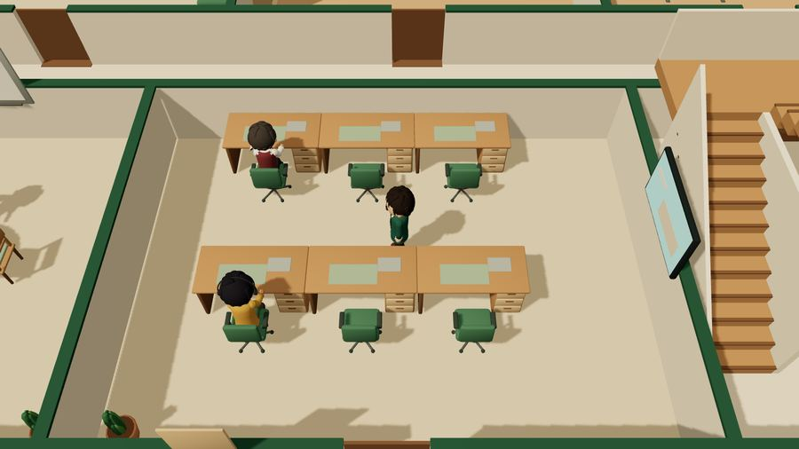
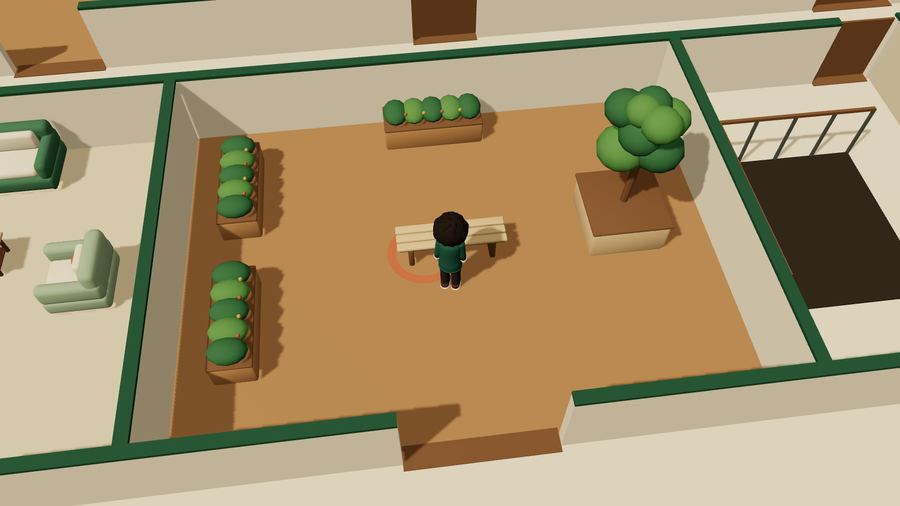
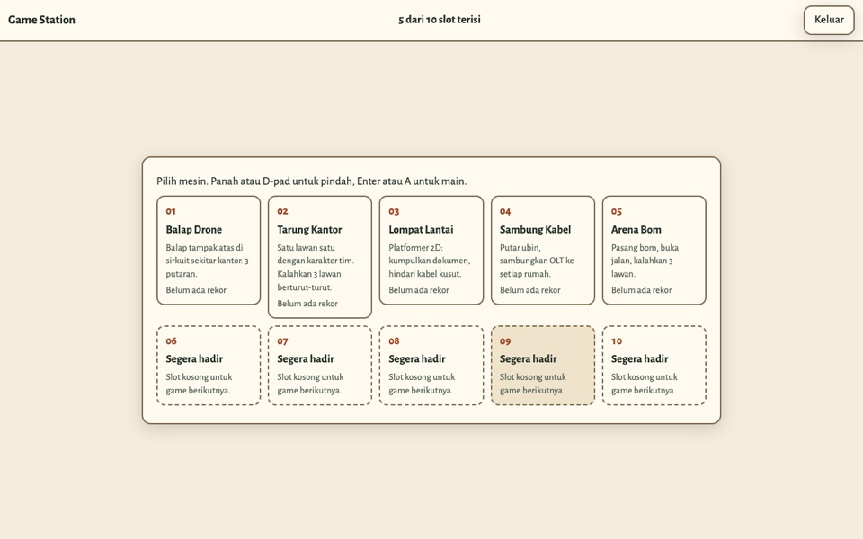
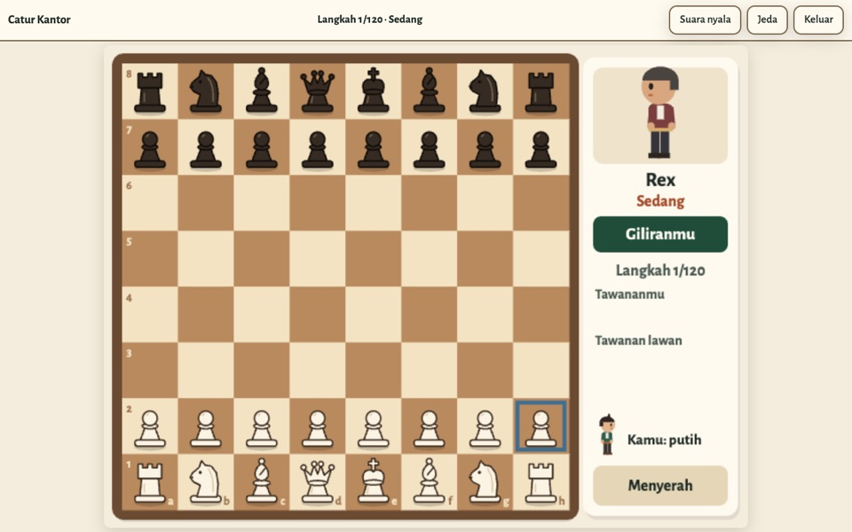
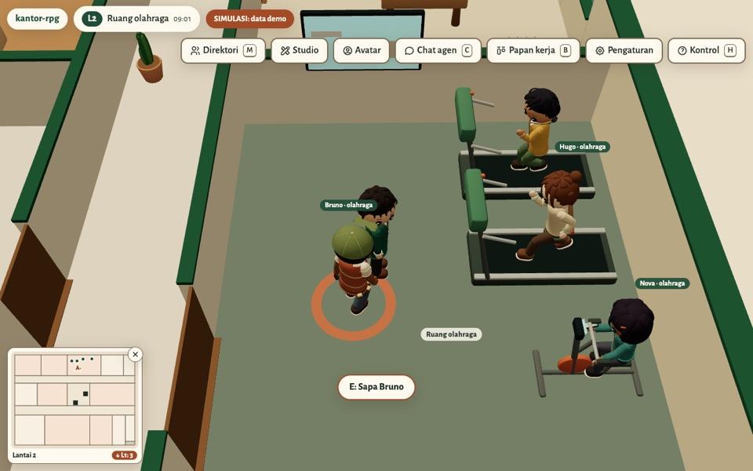

<p align="center"><a href="README.md">Bahasa Indonesia</a> · <b>English</b></p>

<p align="center"></p>

<h1 align="center">kantor-rpg</h1>

<p align="center">
A two-floor virtual office that runs in the browser. You can explore the building, talk to its AI team agents, and print its working drawings.
</p>

<p align="center">
<a href="https://employee-rpg.air-buddy.site"><b>Try the demo</b></a> ·
<a href="CHANGELOG.en.md">Changelog</a> ·
<a href="docs/FEATURES.md">All features</a> ·
<a href="INSTALL.en.md">Self-host</a> ·
<a href="LICENSE">MIT License</a>
</p>

<p align="center"></p>

You play as the CEO in a two-floor building built from a single data file, `design/world.json`. From that same file, the scripts in this repo generate a Blender 3D model, 15 CAD drawing sheets, a network design, and the world you explore in the browser. Move one room in the dataset, then rebuild: the floor plans, the model, and the game all change with it.

Eight NPC characters live their own day: working at their desks, making coffee, playing billiards, reading in the library. If you install the private backend, each character connects to a real AI agent. The character sits down and types while its agent works, and you can give it tasks through a chat that syncs with Telegram.

The app runs in English or Indonesian. It follows your browser language, and you can switch in **Settings** or with `?lang=en`. Some docs and screenshots still show the Indonesian labels; the English meaning is given the first time each one appears.

The public demo runs without login. It shows a simulation with a fixed seed, so every visitor sees the same day.

## New in v2.2

Latest version: **v2.2** (14 October 2026). Details are in the [changelog](CHANGELOG.en.md).

- **Play together with several gamepads.** Office Brawl (2 players), Bomb Arena (up to 4), and Office Chess (2 players) can be played together on one screen. Connect another pad and press A on the opening card to join.
- **15 mini games.** The treadmill, dumbbells, mat, billiards, coffee machine, server rack, drafting table, easel, bookshelf, and chess table in the office are playable. The arcade cabinet opens the **Game Station** with 5 games.
- **Chess at the chess table.** Walk up to the board game table in the Game room, take a stool, and play chess against a teammate.
- **Responsive buttons on every screen.** No press gets lost, including on 120 and 144 Hz screens. A button still held no longer falls through to the next menu.
- **Characters really work out.** NPCs run on the treadmill and pedal the exercise bike from its saddle.
- **Music and sound.** 12 original songs in a cozy game style, footsteps, doors, and the lift, all generated in the browser with no audio files.
- **New animations and reprimands.** Walking and running blend smoothly, characters glance at the CEO, and cartoon reprimands that are animation only.

## Numbers

| | |
|---|---|
| Building | 2 floors, 36 rooms, 44 doors, 39 windows |
| Contents | 201 furniture items and devices, 54 furniture GLB models, 118 NPC activity slots |
| Characters | 9 original characters (1 player avatar, 8 NPCs), modeled in Blender |
| Working drawings | 15 architecture, interior, and ICT sheets in DWG, DXF, and PDF |
| Mini games | 15 games: 10 at office facilities, 5 in the Game Station, downloaded when opened |
| Music | 12 original songs, generated in the browser |
| Initial JavaScript download | three.js 168 kB + app 48 kB (gzip) |
| Tests | 368 unit tests, 318 E2E scenarios (desktop, tablet, phone), 432 Python tests, 32 server tests |
| Recorded decisions | 18 ADRs in [docs/decisions.md](docs/decisions.md) |

## Main features

| Feature | In short |
|---|---|
| [Two-floor 3D world](docs/FEATURES.md#2-3d-world) | 36 rooms, doors that open by themselves, stairs and a lift between floors |
| [NPC characters](docs/FEATURES.md#5-npc-characters) | 8 characters with daily schedules, ready to talk, working out on the treadmill and exercise bike |
| [Mini games](docs/FEATURES.md#4a-mini-games) | 10 games at office facilities, chess at the board game table included, and a 5-game Game Station: racing, fighting, platformer, cable puzzle, bomb arena |
| [Animation](docs/FEATURES.md#4d-character-animation) | Walking and running blend with speed, start, stop, turn, glance; a clip for every activity |
| [Reprimand](docs/FEATURES.md#4c-reprimand) | Three cartoon reprimands in 3D; animation only, nothing sent to the agent |
| [Sound](docs/FEATURES.md#4b-sound) | 12 original songs, footsteps, doors, lift; generated in the browser, no audio files |
| [Agent chat and work board](docs/FEATURES.md#10-agent-chat) | Give tasks to AI agents, synced with Telegram (needs the private backend) |
| [Map and minimap](docs/FEATURES.md#6a-map-and-minimap) | Where everyone is on each floor, **Temui** (Meet) to jump next to them |
| [Office Studio](docs/FEATURES.md#8-office-studio-rearranging-furniture) | Rearrange furniture, save drafts, publish, roll back |
| [Avatar Studio](docs/FEATURES.md#7-avatar-studio) | Pick the avatar's hair, colors, and outfit |
| [Controls](docs/FEATURES.md#3-movement-and-camera) | Keyboard, touch screen, and **gamepad** (Xbox, PlayStation, Bluetooth) |
| [Phone HUD](docs/FEATURES.md#3-movement-and-camera) | One row of menu icons; the menu and minimap fold away |
| [Two languages](docs/FEATURES.md#14-settings-and-accessibility) | Indonesian and English, switch in Settings |
| [Working drawings](docs/FEATURES.md#15-working-drawings-and-dataset) | 15 CAD sheets and Blender models from the same dataset as the game |

## Explore the building


**Floor 1 is for work and guests.** A lobby with a reception desk, a large meeting room, a work gallery, a pantry, an implementation room with a plan table, work areas per role, a lab, and a server room.

| Meeting room | Gallery | Implementation room |
|---|---|---|
|  |  |  |


**Floor 2 is for breaks.** A library, a lounge with a coffee bar, a game room, a billiard table, a gym, an indoor garden, and a balcony. Go up by the U-shaped stairs or the elevator in the building core.

| Game room | Billiards | Gym |
|---|---|---|
|  |  |  |

| Lounge | Library | Indoor garden |
|---|---|---|
|  |  |  |

Interior walls are kept low (1.25 m), so the camera sees into every room without any see-through effect. Doors open on their own when the avatar or an NPC comes close.

## Living characters


- **Seeded simulation.** The same seed (`?seed=20261001`) produces the same sequence of activities. The demo can be replayed exactly, and the E2E tests check this.
- **No collisions.** NPCs reserve a chair before sitting and make way for each other in corridors. An NPC that gets stuck picks another destination. NPCs can't trap the avatar either: keep pushing for 2 seconds, or run, and you pass through. Once you're past, the NPC is solid again.
- **Real work status.** With the backend, a character whose agent is working leaves its leisure activity, sits at its desk, and its label changes to `bekerja` (working) or `menunggu keputusanmu` (waiting for your decision).
- **You can greet them.** Greeting an NPC opens its profile, main room, current activity, and a snippet of dialogue. The owner gets a button to assign a task directly.

- **Know who is where.** The minimap in the corner shows everyone on your floor and how many people are on the other floor (`↑ L2: 3`). Press **P** for the full two-floor map, then **Temui** (Meet) to jump right next to that person, even on another floor.


- **Real workouts.** NPCs who pick exercise run on the treadmill belt or sit pedaling the exercise bike, instead of standing next to it.

You can relax too. Every facility opens a mini game: run on the treadmill, lift weights, play 8-ball, make coffee, fix the server rack, play chess at the board game table, and more. The arcade cabinet opens the Game Station with 5 games. If an NPC is using a spot, the app tells you who.

| Game Station | Chess at the table | Gym |
|---|---|---|
|  |  |  |

## Chat with agents

| Agent chat | Team work board |
|---|---|
|  |  |

The chat in the app is the same Telegram conversation, not a copy. Messages from the app continue that agent's Telegram session, and replies show up in both places.

- Typing indicator, sent and read ticks, incoming message sound, unread count in the tab title.
- Photos, files, and voice messages recorded right in the app, up to 10 MB per attachment. Voice is transcribed on your own server.
- Agents can end a reply with three options. One tap sends that option.
- Messages that touch risky actions (deploy, deleting data, costs, sending to clients, access) are held until the owner approves them. Approval expires after 15 minutes and applies only to that task.
- Messages that look like they contain a password, OTP, token, or card number are rejected before sending.
- The work board shows handoffs between agents, the task list, and the activity log. Handoffs stuck for more than 24 hours are flagged as needing attention.
- Push notifications when the tab is closed, and the app can be installed on a phone home screen as a PWA.

Chat and the work board are only active for the owner, who logs in with a password and a 2FA code. Demo visitors see labeled simulated data.

## Rearrange the office


**Office Studio** opens a top-down plan to move, rotate, add, and delete furniture on a 0,25 m grid.

- Every change is validated: furniture must not pass through walls, block a door swing, collide, or cut off the path to any room or staircase. Publishing is rejected if any rule is broken.
- Data outlets attached to furniture move with it, and the panel counts moved, removed, and new outlets.
- Undo and redo, save drafts, local publish, rollback up to 5 versions, JSON export and import.

**Avatar Studio** changes the avatar's hairstyle and clothing palette, with a 3D preview and walk, wave, talk, sit, and type animations.

| Avatar Studio | Directory | Settings |
|---|---|---|
|  |  |  |

## One dataset, many outputs

| Building elevation (A-301) | Network topology (ICT-001) |
|---|---|
|  |  |

`design/world.json` holds the walls, rooms, doors, windows, furniture, and network points. From there:

- `tools/build_design.py` validates the dataset (geometry, access, egress), calculates room capacity, and builds the room schedule, ICT port map, and requirements matrix.
- `cad/generate.py` writes 15 sheets: floor plans, room schedule, furniture layout, elevations, sections, interior finishes, network topology, outlets per floor, racks, cable routes, and port schedule. Output is DXF in millimeters and vector PDF. DWG files are created and reopened in AutoCAD, with logs in `docs/evidence/`.
- `blender/` builds the building, furniture, and characters, exports GLB, then reopens the files to confirm they are valid.
- The app reads the same dataset at runtime, so the 3D world matches the working drawings.

## Play anywhere

 

- **Desktop.** WASD or arrow keys to walk, Shift to run, Q/Z to rotate the camera, R to straighten the camera, +/- to zoom, E to interact, P for the map, C for agent chat, H for the control list.
- **Phone and tablet.** Joystick at the bottom left, Run and Action buttons, drag the screen to rotate the camera. On a phone, and on a phone in landscape or a small tablet, the top menu is one row of icons. The ☰ button folds the menu, the ✕ button on its corner folds the minimap, and the choice is remembered.
- **Two languages.** The interface is in Indonesian and English and follows the browser language. Switch in Settings or with `?lang=en`.
- **Gamepad.** Xbox, PlayStation, and Bluetooth gamepads work in the browser with nothing to install. Left stick walks (full tilt to run), right stick moves the camera, A interacts, B goes back, X runs, Y straightens the camera, LB/RB zoom, Select opens the map, Start opens Settings. The D-pad moves between buttons in every menu and dialog, including the Studio. The gamepad code downloads only once a pad connects. Settings > Controller has four profiles (Standard, Left-handed, Relaxed, Reversed buttons in Japanese style) and a pad diagram that lights up the button you press.
- **Mini games.** Keyboard (arrows/WASD, Space or J = A, K = B), touch buttons, or a gamepad. Esc or P pauses. The tutorial at the start of each game matches the device in use.
- **No WebGL.** The app switches to a directory mode that still shows the rooms and characters.
- **Accessibility.** Light and dark themes, reduced motion mode, a light graphics quality for older devices, screen reader labels, and every dialog works with the keyboard. Color contrast is checked automatically, and pages are tested with axe.

The 3D models are audited so no surfaces flicker (z-fighting). The test `app/tests/unit/coplanar.test.ts` fails if surfaces of different colors overlap again. The latest fix reduced flicker points from 12.908 to 2.689 across 33 camera scenarios ([report](docs/evidence/AUDIT-3D/LAPORAN.md)).

<br clear="right">

## Start in one minute

```bash
git clone https://github.com/air-buddy410/kantor-rpg.git
cd kantor-rpg/app
npm ci
npm run dev        # open http://localhost:5173
```

That is enough for the 3D world, NPCs, Studio, and all visitor features. Production builds, nginx, the chat backend, push notifications, and common issues are covered in **[INSTALL.en.md](INSTALL.en.md)**.

## Technology

- **App:** TypeScript, Vite, three.js. No UI framework.
- **Backend:** Node.js without a framework, one process, data in Node's built-in SQLite. Password and TOTP login, cookie sessions with CSRF, Web Push with VAPID.
- **3D:** Blender 5 driven by Python scripts. GLB optimized with meshopt and mesh quantization.
- **CAD:** DXF generator in Python, vector PDF, DWG through AutoCAD.
- **Tests:** vitest, Playwright, pytest, `node:test`.

## Repo structure

| Folder | Contents |
|---|---|
| `app/` | 3D app, unit tests (vitest) and E2E tests (Playwright) |
| `server/` | Private backend: auth, agent chat, push, attachments |
| `design/` | World, character, dialogue, and requirements datasets; the source of all artifacts |
| `blender/` | Scripts and `.blend` files for the building, characters, furniture |
| `cad/`, `drawings/` | DXF/DWG generator and working drawing PDFs |
| `tools/` | Design build, world validator, GLB audit, 3D flicker probe |
| `PRD/` | Product requirements, latest version [PRD v2.0](PRD/PRD-v2.0.md) (section 12: v2.1 changes) |
| `docs/` | Features, decisions (ADR), QA reports, test evidence, runbooks |

## Tests

```bash
cd app
npx tsc --noEmit
npx vitest run           # includes the z-fighting gate
npx playwright test      # desktop, tablet, phone
cd ../server && npm ci && npm test
```

Rebuilding all design artifacts from a clean clone is described in [docs/REBUILD.md](docs/REBUILD.md):

```bash
pip install -r requirements-dev.txt
python3 tools/build_design.py
python3 -m pytest tests/py -q
```

## Documentation

- [All features, explained one by one](docs/FEATURES.md)
- [Changelog per version](CHANGELOG.en.md)
- [Installation guide](INSTALL.en.md)
- [How to contribute](CONTRIBUTING.en.md)
- [Architecture decisions](docs/decisions.md), ADR-001 to ADR-018
- [QA report](docs/QA-REPORT.md) and [list of skipped tests](docs/SKIP-LEDGER.md)
- [3D audit: z-fighting and flicker](docs/evidence/AUDIT-3D/LAPORAN.md)
- [Device validation](docs/DEVICE-VALIDATION.md)

## License

[MIT](LICENSE) for the entire repo: code, 3D models, characters, working drawings, and documentation. You may use, modify, and sell it, as long as the copyright notice is kept.

All characters and assets were made specifically for this project. Third-party components in the app use their own licenses: three.js (MIT) and the Alegreya Sans font (SIL OFL 1.1). Copies are in `app/public/licenses/`.
