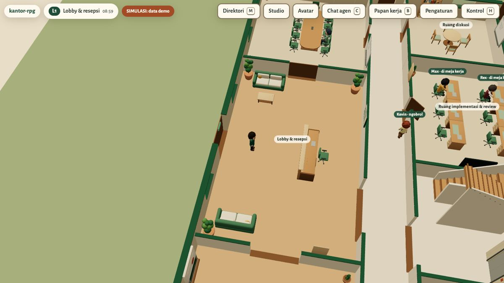
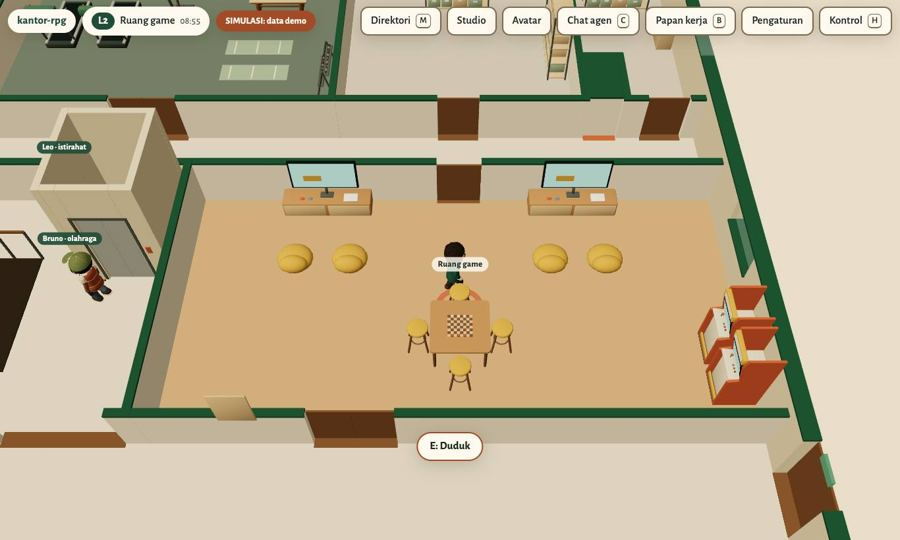

# kantor-rpg

Kantor virtual dua lantai yang bisa dijelajahi di browser. Kamu bermain sebagai CEO, berjalan di antara ruang kerja, dan bertemu karakter agen tim. Gedung, perabot, gambar CAD, model Blender, dan rancangan ICT dibangun dari satu dataset (`design/world.json`).

Coba langsung di **[employee-rpg.air-buddy.site](https://employee-rpg.air-buddy.site)**. Tanpa login, semua data agen adalah simulasi berlabel.



## Isi

- Dua lantai, 38 ruang, 201 perabot dan perangkat, sembilan karakter original. Dunia digambar three.js dengan model GLB dari Blender.
- NPC berjalan, duduk, dan ngobrol menurut simulasi berseed (`?seed=20261001`), jadi demo selalu sama.
- Bisa dimainkan di desktop (keyboard) dan HP (joystick sentuh). Bila WebGL tidak tersedia, app berpindah ke mode direktori.
- Studio untuk menata ulang perabot, dengan undo, ekspor, dan rollback.
- Papan kerja tim: handoff antar-agen, daftar pekerjaan, dan log aktivitas.
- Chat agen yang menyambung obrolan Telegram yang sama: status mengetik, centang baca, notifikasi push, foto, berkas, dan pesan suara. Fitur ini butuh backend privat dan login pemilik (sandi + 2FA).
- 15 sheet gambar kerja (arsitektur, interior, ICT) dalam DWG dan PDF, di `cad/out/` dan `drawings/`.

| Lantai 2 | Chat agen | Papan kerja |
|---|---|---|
|  |  |  |

## Mulai

```bash
git clone https://github.com/air-buddy410/kantor-rpg.git
cd kantor-rpg/app
npm ci
npm run dev        # http://localhost:5173
```

Kontrol: WASD atau panah untuk jalan, Shift untuk lari, Q/Z memutar kamera, R meluruskan kamera, +/- zoom, E untuk interaksi, H untuk bantuan.

Build produksi, nginx, backend chat, dan masalah umum ada di **[INSTALL.md](INSTALL.md)**.

## Struktur repo

| Folder | Isi |
|---|---|
| `app/` | App 3D (Vite + TypeScript + three.js), tes unit (vitest) dan E2E (Playwright) |
| `server/` | Backend privat Node tanpa framework: auth, chat agen, push, lampiran |
| `design/` | Dataset dunia, karakter, dialog, dan kebutuhan; sumber semua artefak |
| `blender/` | Skrip dan berkas `.blend` untuk gedung, karakter, perabot |
| `cad/`, `drawings/` | Generator DXF/DWG dan PDF gambar kerja |
| `tools/` | Build desain, validator dunia, audit GLB, probe kedip 3D |
| `PRD/` | Kebutuhan produk; versi terbaru [PRD v1.1](PRD/PRD-v1.1.md) (bagian 19: chat dan agen hidup) |
| `docs/` | Keputusan (ADR), laporan QA, bukti uji, runbook |

## Tes

```bash
cd app
npx tsc --noEmit
npx vitest run           # termasuk gate z-fighting
npx playwright test      # desktop, tablet, mobile
cd ../server && npm ci && npm test
```

Rebuild artefak desain (dataset, PDF, CAD) dari clean clone dijelaskan di [docs/REBUILD.md](docs/REBUILD.md). Langkah intinya:

```bash
pip install -r requirements-dev.txt
python3 tools/build_design.py     # seed, validasi, kapasitas, room schedule, ICT, matriks, PDF PRD
python3 -m pytest tests/py -q
```

## Dokumen

- [Keputusan arsitektur](docs/decisions.md), ADR-001 sampai ADR-017
- [Laporan QA](docs/QA-REPORT.md) dan [daftar tes yang dilewati](docs/SKIP-LEDGER.md)
- [Audit 3D: z-fighting dan kedip](docs/evidence/AUDIT-3D/LAPORAN.md)
- [Validasi perangkat](docs/DEVICE-VALIDATION.md)
- [Progres per milestone](docs/progress.md)

## Catatan

Proyek pribadi Budi Prabhawa, dikerjakan bersama agen Hermes dengan Max sebagai supervisor. Repo ini tidak berisi aset/kode Holixora, Pokemon, chat pribadi, atau kredensial. Angka ukuran dan performa di dokumen desain adalah target, kecuali yang jelas disebut hasil pengukuran.

Lisensi belum ditentukan. Kode boleh dibaca dan dicoba; pemakaian ulang atau distribusi butuh izin pemilik.
