[Bahasa Indonesia](FITUR.md) · **English**

# Kantor RPG Features

This document describes each feature from the user's side: what you see, how to use it, and its limits. For installation, see [INSTALL.en.md](../INSTALL.en.md).

Table of contents

1. [Two modes: visitor and owner](#1-two-modes-visitor-and-owner)
2. [3D world](#2-3d-world)
3. [Movement and camera](#3-movement-and-camera)
4. [Interaction and activities](#4-interaction-and-activities)
5. [NPC characters](#5-npc-characters)
6. [Directory](#6-directory)
   - [Map and minimap](#6a-map-and-minimap)
7. [Avatar Studio](#7-avatar-studio)
8. [Office Studio: rearranging furniture](#8-office-studio-rearranging-furniture)
9. [Team work board](#9-team-work-board)
10. [Agent chat](#10-agent-chat)
11. [Approval for risky actions](#11-approval-for-risky-actions)
12. [Push notifications and installed app](#12-push-notifications-and-installed-app)
13. [Owner login](#13-owner-login)
14. [Settings and accessibility](#14-settings-and-accessibility)
15. [Working drawings and dataset](#15-working-drawings-and-dataset)
16. [URL parameters](#16-url-parameters)
17. [Privacy and data](#17-privacy-and-data)

---

## 1. Two modes: visitor and owner

The app has two layers that are kept separate on purpose.

| | Visitor (no login) | Owner (password + 2FA login) |
|---|---|---|
| 3D world, NPCs, directory, studio | Yes | Yes |
| NPC status | Simulated | Real work status from agents, when available |
| Work board | Sample data labeled `Demo` | Real data, read-only |
| Agent chat | Login form only | Chat and assign tasks |
| Push notifications | No | Yes |

The orange label `SIMULASI: data demo` (SIMULATION: demo data) at the top of the screen marks that what you see is not real data. Visitors cannot send anything to the agents.

Owner features need the private backend (`server/`). Without the backend, the app still runs fully in visitor mode.

## 2. 3D world

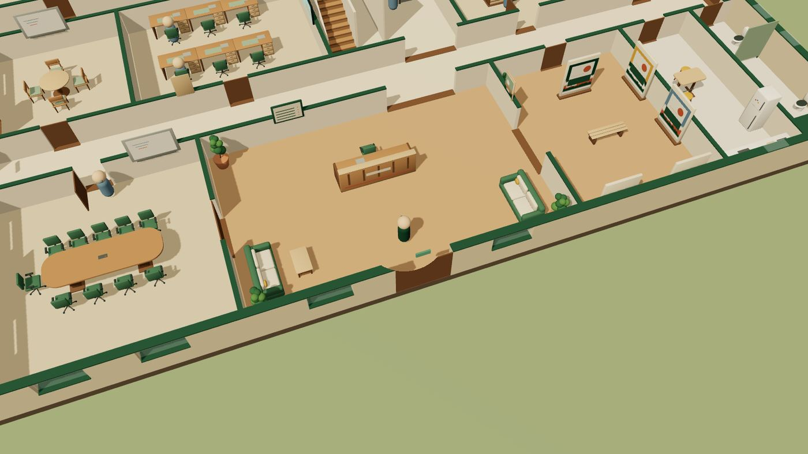

- Two floors: **Lantai 1 (kerja dan kunjungan)** (Floor 1, work and visits) and **Lantai 2 (rekreasi)** (Floor 2, recreation), with 38 rooms, 46 doors, 39 windows, and 201 pieces of furniture and equipment in total.
- Floor 1 has the lobby and reception (the starting point), a large meeting room, a gallery, a pantry, discussion rooms, an implementation room, work areas per role, a lab, a server room, and a storage room (the ICT riser was removed on 2026-10-13 at Budi's request; its area joined the storage room).
- Floor 2 has a library, a lounge and coffee bar, a dining room, showers, a game room, a billiard room, a gym, an indoor garden, and a balcony.
- Change floors using the **U-stair** or the **lift** in the building core. The outdoor emergency stair is only a concept marker and cannot be used.
- Walls that block the view are cut away automatically, including windows and door leaves, so the avatar is always visible.
- Doors open on their own when the avatar or an NPC comes near. Restricted rooms are locked in visitor mode (see section 14).
- Room and character labels are hidden when covered by a menu, the joystick, or an interaction hint, so text does not overlap.

| Lobby | Meeting room | U-stair |
|---|---|---|
|  |  | 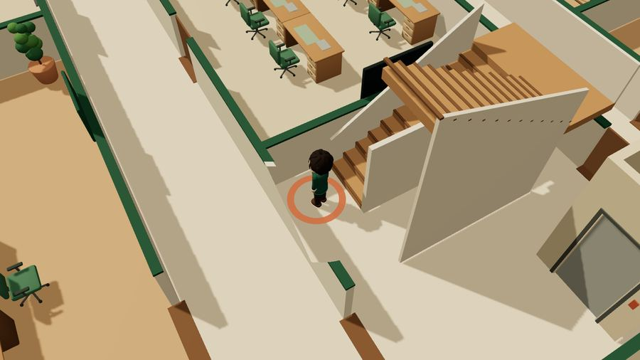 |

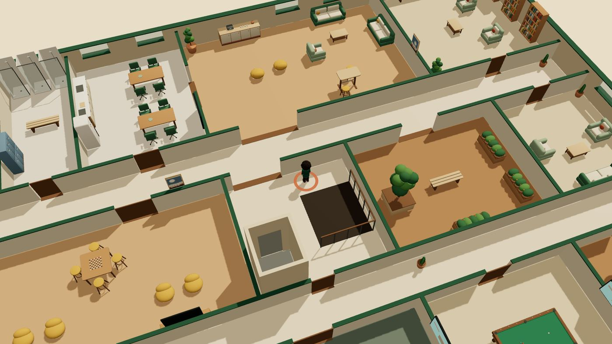

| Game room | Billiards | Gym |
|---|---|---|
|  |  | 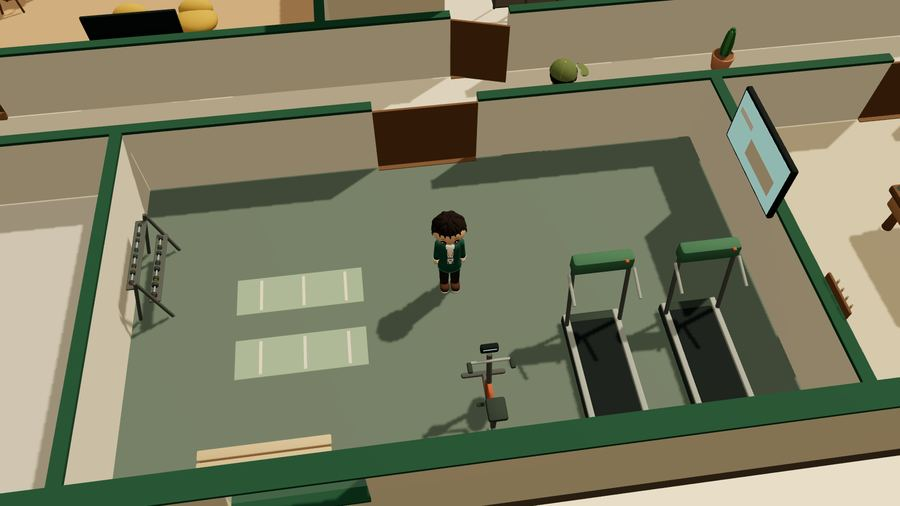 |

The GLB models are made in Blender. Touching surfaces are offset by a few millimeters at load time, so there is no flicker (z-fighting). The test `app/tests/unit/coplanar.test.ts` fails if surfaces with different colors touch again.

## 3. Movement and camera

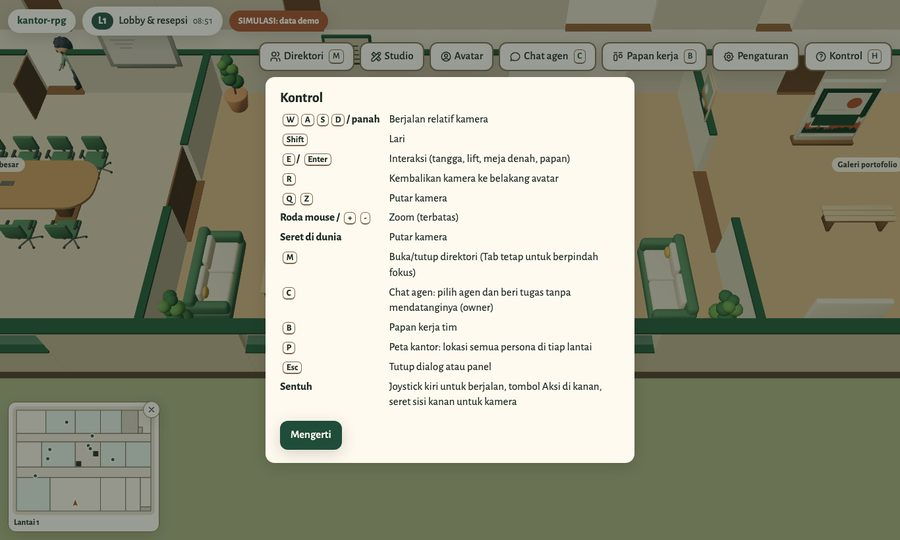

Press **H** or the **Kontrol** (Controls) button to see this list inside the app.

| Key | Action |
|---|---|
| W A S D / arrows | Walk, direction relative to the camera |
| Shift | Run |
| E / Enter | Interact with the nearest object or character |
| R | Reset the camera behind the avatar |
| Q / Z | Rotate the camera |
| Mouse wheel / + / - | Zoom (with near and far limits) |
| Drag in the world | Rotate the camera |
| M | Open or close the directory |
| C | Agent chat (owner) |
| B | Team work board |
| P | Office map: location of every persona |
| Esc | Close a dialog or panel |

**On phones and tablets**

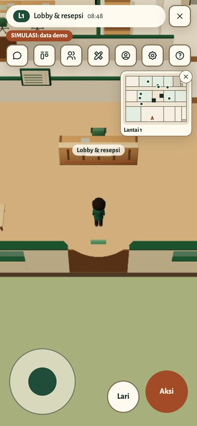 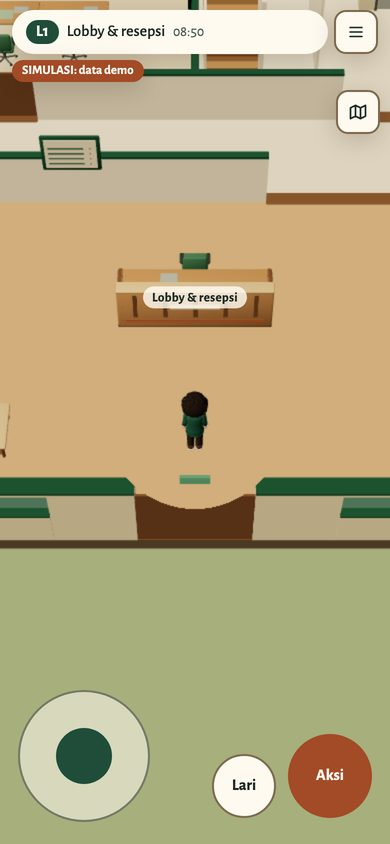

- The joystick at the bottom left is for walking. Pushing the joystick to the edge makes the avatar run.
- The **Lari** (Run) button turns running on or off.
- The **Aksi** (Action) button is the same as E.
- Drag the right side of the screen to rotate the camera.
- The top menu is one row of icons (two rows on screens narrower than 356 px). Screen readers still read each button name.
- The **☰** button next to the room name folds or opens the menu. The **✕** button on the minimap corner folds it into a map icon. The fold choice survives a page reload.

**With a gamepad**

Xbox, PlayStation, and Bluetooth gamepads with the standard mapping work in the browser. Connect the pad and press any button. A "Gamepad connected" notice appears.

| Button | Action |
|---|---|
| Left stick | Walk. Full tilt to run |
| Right stick | Turn and tilt the camera |
| A (✕ on PlayStation) | Interact, same as E. In menus: select |
| B (○) | Back or close the dialog, same as Esc |
| X (□) | Run on/off |
| Y (△) | Straighten the camera behind the avatar |
| LB / RB | Zoom out / in |
| Select | Office map |
| Start | Settings |
| D-pad | Move to the nearest button in that direction, in the HUD and inside dialogs |

While a dialog is open, the avatar stays still and the left stick also moves focus. Left/right change dropdown values. In the Studio, the D-pad moves the selected fixture. Typing text still needs a keyboard or the on-screen keyboard.

**Controller profiles (Settings > Controller)**

There are four profiles. The choice is saved in the browser and applies right away, without a reload.

| Profile | For whom | Difference from Standard |
|---|---|---|
| Standard | Most players | Left stick walks, right stick camera, 22% dead zone, full tilt runs |
| Left-handed (sticks swapped) | Left-handed players, or anyone who prefers steering the camera with the left hand | Right stick walks, left stick camera. Inside dialogs the right stick moves focus. All other buttons stay the same |
| Relaxed (slow camera) | Players who get dizzy with a fast camera, or an older pad whose sticks drift | Camera at 58% of normal speed, 32% dead zone, full tilt does not run (run with Square/X or by pressing the left stick) |
| Reversed buttons (Japanese style) | Players used to Japanese consoles or the Nintendo Switch | Cross and Circle swap, Square and Triangle swap: Circle interacts/selects, Cross goes back/closes, Triangle runs, Square straightens the camera. Sticks, D-pad, L1/R1, Create, Options unchanged |

Below the profile choice is a DualSense-style controller drawing with what each button does in that profile. While a pad is connected, pressed buttons light up and the drawn sticks move, so players can check their pad is read. Pointing at or focusing a row in the button list highlights that button in the drawing. The body, grips and touchpad follow Leo's controller drawing (mockup39), with no logo or brand name.

The avatar cannot pass through walls or furniture. NPCs also block the avatar, but cannot trap it: keep pushing into an NPC for 2 seconds, or run (Shift, the Run button, full stick tilt), and the avatar passes through. Once past, the NPC is solid again. If the avatar's position becomes invalid (for example after furniture is moved), the avatar is returned to the nearest safe point.

## 4. Interaction and activities

When the avatar is near something usable, a hint appears at the bottom of the screen, for example `E: Pakai tangga ke Lantai 2` (E: Use stairs to Floor 2). Usable objects:

| Object | Action |
|---|---|
| Stairs and lift | Change floors |
| Plan table | Read the floor plan and ICT design |
| Directory board | Open the directory |
| Wall boards | Open the Handoff Board, Task List, or Activity Log |
| Gallery works | View the work |
| Coffee machine | Make coffee |
| Billiard table | Play billiards: each shot is random, score kept only for the session |
| Game console | Play a game round, no saved score |
| Gym equipment | Work out |
| NPC character | Greet, then open the profile and dialog |

These activities are virtual. They do not change anyone's work status. If a spot is in use by an NPC, the app tells you who is using it. The **Selesai** (Done) button or E ends the activity.

## 5. NPC characters

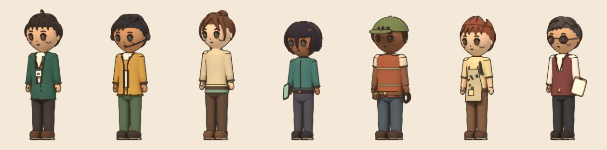

- There are nine original characters: one player avatar (CEO) and eight NPC personas with different roles, such as supervisor, design, ICT specification, network installation, visual materials, and review and QA.
- NPCs choose their own activities: working at a desk, making coffee, chatting, reading, stretching, playing games, billiards, working out, or resting. Choices come from 118 activity slots in the world.
- The simulation uses a fixed seed (`?seed=20261001` by default). The same seed produces the same sequence of activities, so demos are repeatable.
- NPCs give way to each other and reserve chairs before sitting, so they do not overlap. A stuck NPC picks another destination.
- The clock in the HUD (`08:53`) is simulation time, not real time.
- The label above each head shows the name and activity, for example `Echo · ngobrol` (Echo · chatting).

**Real work status (owner).** When the agent behind a character is working on a task, the character stops relaxing, sits at its desk, and types. Its label changes to `<nama> · bekerja` (<name> · working) or `<nama> · menunggu keputusanmu` (<name> · waiting for your decision). This status is fetched from the backend every 10 seconds (30 seconds when the tab is inactive). Dialog and leisure activities stay fictional.

Greeting an NPC opens the profile panel: role, main room, current activity, simulation time, and a snippet of dialog. The **Topik lain** (Another topic) button changes the dialog. The owner also gets a **Bicara & beri tugas** (Talk & assign task) button.

## 6. Directory

Press **M** or the **Direktori** (Directory) button. It contains:

- A list of rooms per floor with code, function, and a **Pergi** (Go) button. The avatar walks to that room on its own. Locked rooms are marked `terkunci` (locked) along with the reason.
- A list of personas with **Profil** (Profile), **Temui** (Meet, walks to that character), and **Beri tugas** (Assign task, owner) buttons.
- Agents that do not yet have a character in the world can still be assigned tasks from here.
- Shortcuts to the three work board tabs.
- Links to project documents.

If the browser does not support WebGL, the directory becomes the main view. The **Pergi** button becomes **Info**.

## 6a. Map and minimap

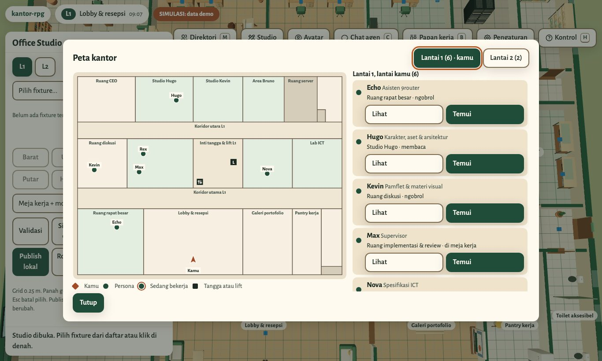

Finding one person in a two-floor building does not require walking around.

The **minimap** sits in the bottom left corner (on phones: top right, below the HUD, so it does not collide with the joystick).

The ✕ button on the minimap corner folds the minimap into a map icon. The fold choice survives a page reload.

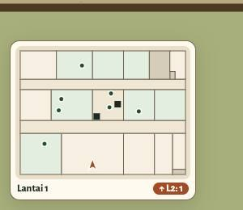

- The plan of your current floor, colored by room type.
- The orange arrow is you, pointing in the direction you face. Green dots are personas; dots with a ring are working or waiting for your decision. Black squares are stairs and lifts.
- The badge `↑ L2: 3` means three people are on the upper floor. On Floor 2 the badge is `↓ L1: n`.
- Updated four times per second. Click or tap to open the full map.

**Office map** (the **P** key, or click the minimap):

- One tab per floor, with the number of people on each floor. The map opens on your floor.
- A full plan with room names and the name of each persona.
- The list is grouped: your floor first, then other floors with the note **Beda lantai** (Different floor) and the tag `L2, beda lantai` (L2, different floor) on each person. Each row shows role, room, and current activity.
- A persona walking to the stairs or lift is shown as `<ruang>, menuju Lantai 2` (<room>, heading to Floor 2), so you know they are about to move.
- **Lihat** (View) highlights that person on the map, switching floor tabs if needed. Clicking a dot on the plan also works.
- **Temui** moves you next to that person, including going up or down floors, then opens their profile.
- In visitor mode, restricted rooms are hatched.

All buttons work with a keyboard and screen readers. The minimap label states your floor and the number of people on each floor. The map shows character positions in the simulated world, not the physical location of real people.

## 7. Avatar Studio

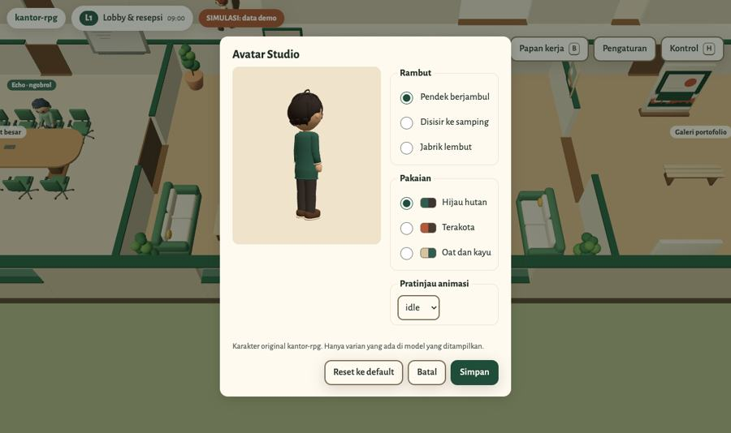

The **Avatar** button opens a 3D preview of the player avatar.

- Hair: short with a quiff, side-swept, or soft spiky.
- Outfit palette: forest green, terracotta, or oat and wood.
- Animation preview: idle, walk, wave, talk, sit, type.
- **Simpan** (Save) stores your choice in this browser. **Reset ke default** (Reset to default) restores the original look.

Only variants that actually exist in the model are shown.

## 8. Office Studio: rearranging furniture

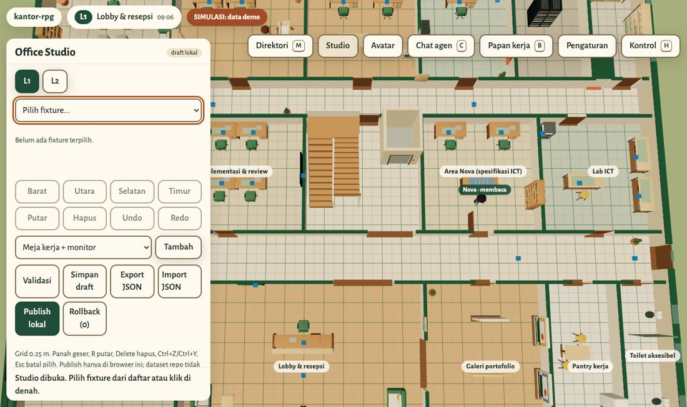

The **Studio** button opens a top-down plan for moving furniture.

**Editing**

- Select furniture from the list or click it on the plan.
- Move with the arrow keys (0.25 m grid), rotate 90 degrees with R, delete with Delete.
- Add new furniture from the type list.
- Undo and redo: Ctrl+Z and Ctrl+Y. Esc clears the selection.
- ICT devices attached to furniture (data outlets) move or get deleted with it. The panel shows how many outlets were moved, deleted, and added.

**Validation.** Every change is checked, and publishing is refused if any rule is broken:

- Furniture goes outside a room or through a wall.
- Two pieces of furniture collide, or one enters another's clearance area.
- Furniture blocks a door or a door's swing area.
- A room, activity slot, or stair end can no longer be reached.

**Saving**

| Button | Result |
|---|---|
| Simpan draft (Save draft) | Stored in the browser; shown again when Studio opens |
| Publish lokal (Publish locally) | Layout is used in the world, in this browser only |
| Rollback | Return to a previous publish (up to 5 versions) |
| Kembali ke dataset (Back to dataset) | Discards the local layout and uses `world.json` |
| Export JSON | Downloads the layout for further processing |
| Import JSON | Loads a layout (max 512 KB); invalid files are rejected without changing the layout |

Studio never changes the repo or the server. To use a new layout permanently, export the JSON and recompute the port map with `tools/ict_derive.py --layout`.

## 9. Team work board

Press **B**, the **Papan kerja** (Work board) button, or approach a board on the wall. There are three tabs:

- **Papan Handoff** (Handoff Board): work handoffs between agents in the last 7 days. Each card shows sender and receiver, title, what was requested, the work chain, project, and age. Handoffs that are blocked or not accepted for more than 24 hours are marked `Perlu perhatian` (Needs attention).
- **Daftar Pekerjaan** (Task List): tasks that are running, waiting, blocked, and done, sorted by which need attention most.
- **Log Aktivitas** (Activity Log): events from the last 24 hours, such as tasks created, picked up, finished, or blocked.

The board is read-only: task changes are still made through the agents. The top of the board shows when the data was last observed. If the data source cannot be read, the board shows a warning and the last data that loaded successfully, not an empty list.

## 10. Agent chat

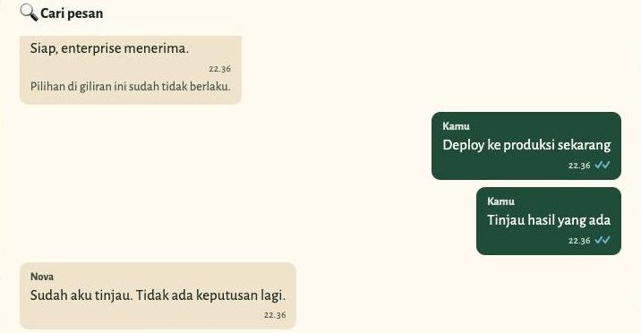

Press **C** or the **Chat agen** (Agent chat) button to open the agent list. Each agent shows its role and status: `Bekerja` (Working), `Menunggu kamu` (Waiting for you), `Siap` (Ready), or `mengetik…` (typing…). Chat can also be opened from a character profile or from the directory.

**Synced with Telegram.** If an agent has a Telegram conversation with the owner, the chat in the app shows the same conversation:

- History is taken from that agent's Telegram session, with source labels (Telegram, from RPG, system) and times.
- Messages from the app continue the active Telegram session instead of starting a new one.
- Agent replies are also sent to Telegram with the label `Dari kantor RPG` (From the RPG office).
- Messages from Telegram and from the app that arrive at the same time are queued, not overwritten.

Agents without a Telegram conversation use an app-only conversation, and the panel says so.

**Feels like a chat app**

- The status `sedang mengetik…` (typing…) is shown while the agent works on a message (up to 10 minutes, so a stuck agent does not appear to type forever).
- Checkmarks: one check means received by the server, two checks mean received by the agent, two blue checks mean the agent has replied.
- `aktif X menit lalu` (active X minutes ago) is counted from the agent's last reply.
- Date separators (Today, Yesterday, or the date).
- **Balas** (Reply, quotes the message) and **Salin** (Copy) buttons on each message.
- A short tone when a new message arrives while the page is open (can be turned off in notification settings), and the tab title shows the unread count.
- **Cari pesan** (Search messages) within the conversation.
- **Mulai percakapan baru** (Start new conversation) to begin a new session.

**Reply options.** An agent can end its reply with three options. Tapping one sends the matching message. Options are valid only while that reply is still the latest; once a new message arrives, old options are marked `Pilihan di giliran ini sudah tidak berlaku` (Options for this turn are no longer valid).

**Attachments and voice**

- Photos (JPG, PNG, WebP, GIF) and files (PDF, TXT, CSV, DOCX, XLSX, ZIP), up to 10 MB per file and 5 attachments per message. Photos can be pasted or dragged into the message field.
- Voice messages are recorded in the browser, then transcribed locally on the server (up to 180 seconds) before being sent to the agent.
- File contents are checked against their type; files that do not match their extension are rejected.

**Message limits**

- Up to 4,000 characters per message and 5 queued tasks per agent.
- Messages that appear to contain passwords, OTPs, tokens, API keys, or card numbers are rejected before sending.
- Ctrl/⌘ + Enter sends, Esc closes without sending.
- The same message is not sent twice if the send button is pressed again.
- Tasks that are still running can be cancelled.

## 11. Approval for risky actions

Before being passed to an agent, every message is matched against a list of risky categories:

- production network devices or systems,
- servers: restart, VM, or upgrade,
- deleting or resetting data,
- deploying or merging to production,
- costs or payments,
- sending something to a client,
- credentials or access rights.

Matching messages are held with the status `Menunggu persetujuan` (Awaiting approval). The panel shows the action, its impact, and the rollback path. The owner must press **Setujui untuk tugas ini** (Approve for this task) within 15 minutes. Approval applies only to that task, not to later ones.

## 12. Push notifications and installed app

- The **Aktifkan notifikasi** (Enable notifications) button asks for browser permission, then sends a test notification. Permission is never requested without this button.
- Notifications contain the agent name and a reply snippet (up to 120 characters). Tapping a notification opens that agent's chat.
- Notifications can be muted per agent per device.
- Push uses the Web Push standard (RFC 8291 and VAPID) directly from your own backend, with no paid third-party service. The only destinations are the browsers' official push services.
- The app can be installed to a phone's home screen as a PWA (`manifest.webmanifest` and a service worker). On iPhone, notifications only work when the app is opened from the home screen.

## 13. Owner login

- Login uses a password and a 6-digit 2FA code from an authenticator app.
- The account is created once through a one-time setup link. The password is stored as a hash, and the 2FA secret is never sent to the browser.
- Wrong passwords, wrong codes, or already-used codes are rejected. Five failures within 15 minutes lock login temporarily.
- Sessions last 12 hours. **Keluar** (Log out) ends the session on the server.
- Requests that change data must carry a CSRF token and come from the site origin.
- The backend only accepts requests that pass through the nginx proxy with a secret header. Direct requests are rejected.

## 14. Settings and accessibility

| Setting | Options |
|---|---|
| Theme | Follow system, light, dark |
| Graphics quality | Auto, low (no shadows), high. Auto picks low when the browser uses a software renderer |
| Reduce motion | Turns off secondary animations. Follows the system setting by default |
| Visitor mode | Locks restricted rooms (server room, shaft). The avatar is moved to a safe point if it is inside one |
| Language | Indonesian or English. The default follows the browser language: an Indonesian browser gets Indonesian, everything else gets English. Switching reloads the page |

Settings are stored in the browser.

Accessibility:

- All dialogs work with a keyboard; Tab moves focus, Esc closes.
- Buttons have screen reader labels, and important announcements are read out through `aria-live`.
- Color contrast is checked automatically, and pages are tested with axe with no violations.
- Without WebGL, the app is still usable through the directory (see section 6).

## 15. Working drawings and dataset

All artifacts are generated from one source, `design/world.json`. When the dataset changes, the drawings, 3D models, and app change with it on rebuild.

| Building elevation (A-301) | Network topology (ICT-001) |
|---|---|
|  |  |

| Code | Contents |
|---|---|
| A-001 | Cover, index, and general notes |
| A-101, A-102 | Floor 1 and Floor 2 plans |
| A-103 | Room schedule, doors, and windows |
| A-201, A-202 | Floor 1 and Floor 2 furniture layout |
| A-301 | Elevations |
| A-401 | Sections |
| I-101 | Interior finishes and materials |
| ICT-001 | Network topology |
| ICT-101, ICT-102 | Outlets, access points, and cameras per floor |
| ICT-201 | Rack elevation |
| ICT-301 | Pathways and vertical backbone |
| ICT-401 | Port and device schedule |

- Per-sheet and combined PDFs are in `drawings/pdf/`; DXF and DWG are in `cad/out/`.
- Blender models (`blender/out/*.blend`) and GLB files for the app (`app/public/assets/`).
- The ICT design is virtual: a planning example, not a real installation.
- How to rebuild: [docs/REBUILD.md](REBUILD.md).

## 16. URL parameters

| Parameter | Function |
|---|---|
| `?seed=<angka>` | NPC simulation seed (default 20261001) |
| `?nogl=1` | Force no-WebGL mode (directory) |
| `?chat=<agen>` | Open a specific agent's chat directly (used by notifications) |
| `?perf=route&seconds=60&report=1` | Automated performance test route, then show an FPS report |
| `?a11ylog=1` | Log accessibility announcements for screen reader testing |
| `?lang=en` or `?lang=id` | Force the display language for that visit |

## 17. Privacy and data

- Visitor mode sends no data to the server beyond loading the page and assets.
- Settings, avatar, drafts, and Studio layouts are stored only in the browser.
- The backend keeps messages for 30 days and audit logs for 90 days, in a data folder with 0700 permissions.
- Work status summaries shown on NPCs are filtered and truncated to 70 characters. Agent profiles marked private never appear.
- Bot tokens and other secrets exist only on the server and are never sent to the browser.

---

Kantor RPG is released under the [MIT license](../LICENSE).
